<p align="center">
  
</p>

<h1 align="center">SWISSNAND Backup</h1>

<p align="center">
  <b>Verschlüsselte, deduplizierte Backups für Ubuntu Server und Windows Server – mit moderner Web-Konsole und CLI.</b><br>
  Ein Produkt von <b>SWISSNAND Tools</b> · Swiss made software
</p>

<p align="center">
  
  
  
  
</p>

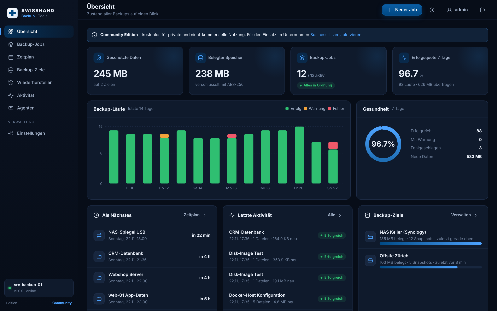

---

## Warum SWISSNAND Backup?

- **Sicher ab dem ersten Byte:** Alles wird verschlüsselt, *bevor* es den Server verlässt (AES-256-GCM). Ohne dein Passwort kann niemand die Daten lesen, auch nicht der Speicheranbieter.
- **Speichersparend:** Dank Deduplizierung auf Blockebene und Kompression sind nach dem ersten Lauf alle weiteren Backups *forever-incremental*. Trotzdem ist jeder Snapshot ein vollständiger Wiederherstellungspunkt.
- **Einfach bedienbar:** Ein Assistent führt in 8 Schritten zum fertigen Job. Wiederherstellen per Klick im Datei-Browser, einzelne Dateien oder ganze Ordner als ZIP.
- **Ein Backup-Server für das ganze Netz:** Agenten auf Linux- und Windows-Servern holen ihre Aufträge verschlüsselt beim Backup-Server ab. Zeitpläne, Verlauf, Wiederherstellung und Meldungen steuerst du zentral.
- **Ein einziges Programm:** Keine Datenbank, keine Laufzeitumgebung, keine Abhängigkeiten. Eine Datei für Linux, eine für Windows – oder ein Container für Docker und Kubernetes.

## Funktionen

| Bereich | Möglichkeiten |
|---|---|
| **Backup-Modi** | **Vollbackup** (alles neu lesen), **inkrementell** (Änderungen seit dem letzten Lauf), **differenziell** (Änderungen seit dem letzten Vollbackup), kombinierbar mit automatischem Vollbackup wöchentlich/monatlich. Jeder Snapshot ist dank Deduplizierung ein vollständiger Wiederherstellungspunkt, ohne Ketten |
| **Zentraler Backup-Server** | Agenten für Linux, Windows, Docker und Kubernetes (DaemonSet). Nur ausgehende HTTPS-Verbindungen, Registrierung per Einmal-Token, Zertifikats-Pinning. Jobs pro Rechner zuweisen, live verfolgen, abbrechen, Wiederherstellung direkt auf den Zielrechner. Agentenlos für Netzfreigaben und Datenbanken übers Netz |
| **VMs & Bare Metal** | **Proxmox VE** (vzdump-Stream, dedupliziert), **Hyper-V** (Export-VM im laufenden Betrieb), **Disk-Images** von Disks und LVM-Volumes (optional per LVM-Snapshot), **Windows Bare Metal** über Windows Server-Sicherung |
| **Backup-Varianten** | Datei-Backup (forever-incremental), aktives Vollbackup, periodisches Vollbackup (wöchentlich/monatlich), synthetische Vollbackups, **Spiegelung/Sync** mit Papierkorb, **Archiv** (.tar.gz, optional AES-256), **Backup-Kopie 3-2-1** auf ein zweites Ziel, **Integritätsprüfung**, **Bereinigung** |
| **Quellen** | Ordner & Dateien, **PostgreSQL** (pg_dump/pg_dumpall), **MySQL/MariaDB** (transaktionssicher), **Docker-Volumes** (Container optional stoppen), **beliebige Befehle** als Stream (LDAP, Redis, AD-Export …), **Windows VSS**-Schattenkopien für geöffnete Dateien |
| **Ziele** | Lokal / USB / **NAS** (NFS, SMB, iSCSI), **S3-kompatibel** (AWS, Wasabi, MinIO, Backblaze B2, Cloudflare R2, Exoscale, Infomaniak), **WebDAV** (Nextcloud, kDrive, Synology), **rclone** (SFTP, OneDrive, Google Drive, Azure, Dropbox und 70+ weitere) |
| **Zeitpläne** | Manuell, Intervall (ab 5 min), täglich mit mehreren Uhrzeiten, wöchentlich, monatlich (inkl. «letzter Tag»), **Cron**, **Job-Verkettung** («nach Job X, nur bei Erfolg»), **Backup-Fenster** (auch über Mitternacht), **Pausen** (Ferien, Migration), zufällige Verzögerung, **Nachholen** verpasster Läufe, Wochenkalender-Ansicht |
| **Aufbewahrung** | GFS (Grossvater-Vater-Sohn): letzte N, stündlich, täglich, wöchentlich, monatlich, jährlich, «alles der letzten N Tage», Vorlagen (Standard, Kompakt, Revisionssicher 10 Jahre …), automatisches Prune |
| **Optionen** | Kompression (aus/schnell/auto/max), parallele Uploads, Bandbreitenlimit, Priorität (nice/ionice), Wiederholungen mit Pause, Zeitlimit, Prüfung nach dem Backup (Stichprobe oder 100 %), Ausschlussmuster (`*.tmp`, `node_modules`, `/var/log/**`), Grössenlimit, CACHEDIR.TAG, «im Dateisystem bleiben», Tags, **Pre/Post/Fehler-Skripte** |
| **Wiederherstellung** | Datei-Browser mit Suche, einzelne Dateien herunterladen, Ordner als ZIP, Wiederherstellung an den Originalort oder einen anderen Ordner, Überschreib-Regeln (umbenennen/überschreiben/nur neuere/überspringen), SHA-256-Prüfung, Besitzer & Rechte |
| **Benachrichtigung** | E-Mail (SMTP mit STARTTLS/TLS), Webhooks mit automatischem Format für **Slack, Microsoft Teams, Discord, ntfy, Gotify** oder generisches JSON |
| **Betrieb** | Web-Konsole (Dark/Light), vollständige **CLI**, REST-API mit API-Tokens (Monitoring mit Zabbix, PRTG, Checkmk), systemd-Dienst, Windows-Dienst, Audit-Log |

## Sicherheit

| | |
|---|---|
| Verschlüsselung | AES-256-GCM (authentifiziert), zufälliger 256-Bit-Master-Key pro Repository |
| Passwort → Schlüssel | PBKDF2-HMAC-SHA256 mit 600 000 Iterationen, mehrere Passwörter pro Repository möglich |
| Integrität | Chunk-IDs = HMAC-SHA256 (kein Fingerprinting durch den Anbieter), SHA-256 pro Datei, jede gelesene Information wird kryptografisch verifiziert, Objekte sind an ihren Namen gebunden (kein Vertauschen) |
| Ransomware-Schutz | **S3 Object Lock** (Governance/Compliance, WORM), Backup-Kopien auf getrennte Ziele, Sperren gegen gleichzeitiges Prune |
| Web-Konsole | Nur HTTPS (TLS 1.2+, automatisches Zertifikat oder eigenes), HSTS, strikte Content-Security-Policy, CSRF-Schutz, HttpOnly/SameSite-Cookies, Sitzungs-Timeout |
| Konten | **2FA (TOTP)**, erzwingbar für alle, Rollen (Admin / Operator / Nur lesen), Passwort-Richtlinie, Brute-Force-Sperre (5 Versuche / 15 min), IP-Allowlist, **Audit-Log** |
| Zugangsdaten | Repository-Passwörter, S3-Keys und SMTP-Passwörter werden verschlüsselt gespeichert (lokaler Schlüssel, nur für den Dienst lesbar). DB-Passwörter erscheinen nie in der Prozessliste |
| Wiederherstellung | Schutz vor Path-Traversal, atomares Schreiben, Prüfsummen-Kontrolle |
| Lieferkette | **Keine Fremdabhängigkeiten**, nur die Go-Standardbibliothek |

Details zum Format und zum Melden von Sicherheitslücken: [SECURITY.md](SECURITY.md).

## Screenshots

| | |
|---|---|
|  **Agenten im ganzen Netz** | 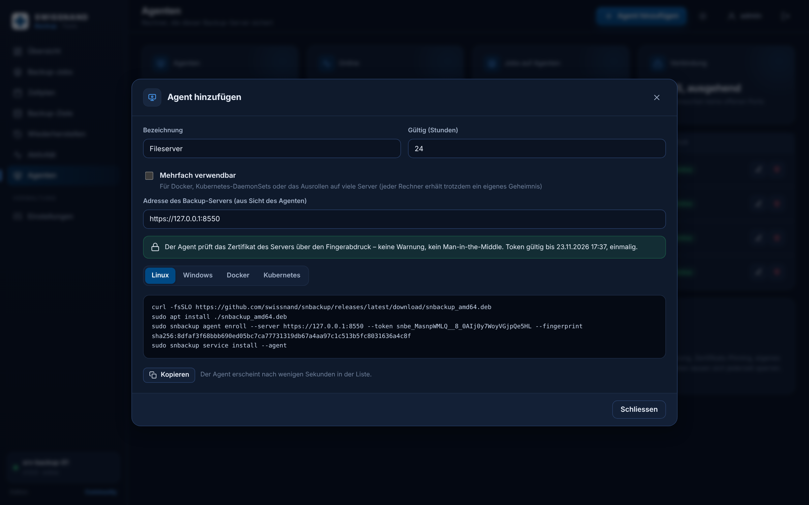 **Agent hinzufügen: Linux, Windows, Docker, Kubernetes** |
|  **Backup-Jobs pro Rechner** | 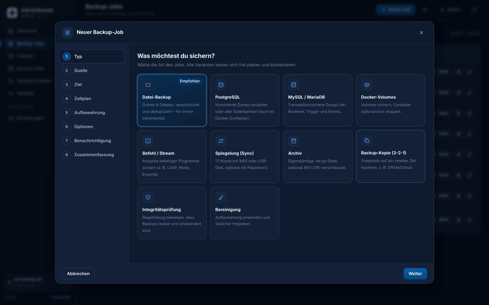 **Job-Assistent: 14 Varianten** |
| 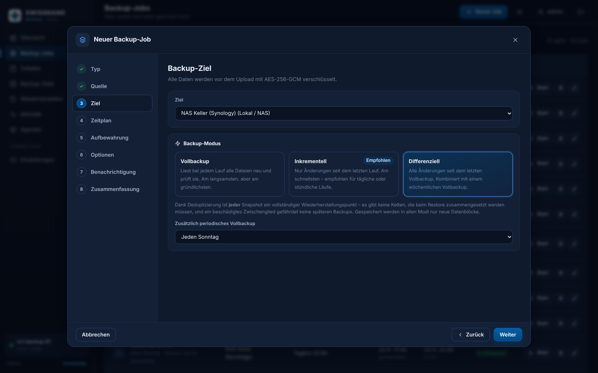 **Voll, inkrementell, differenziell** | 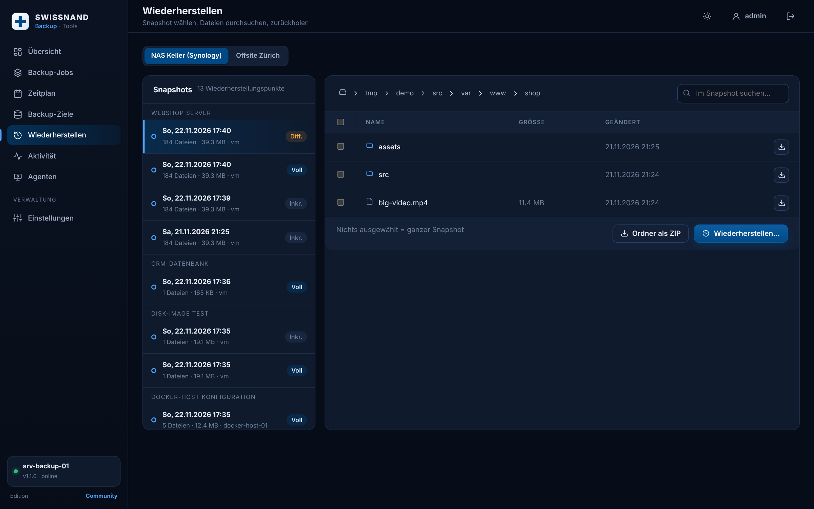 **Snapshots mit Modus** |
| 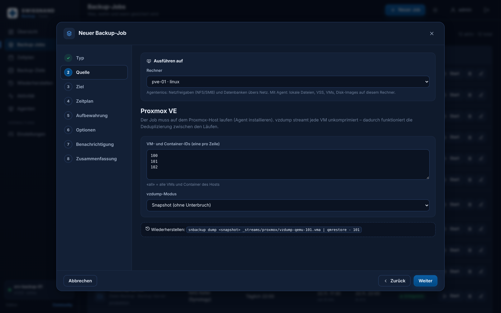 **Proxmox-VMs über den Agent** | 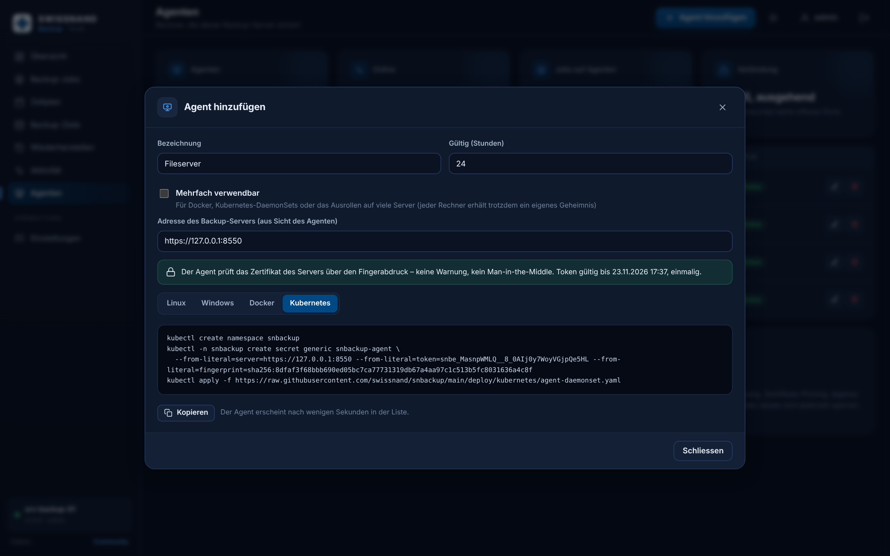 **Kubernetes-DaemonSet** |
| 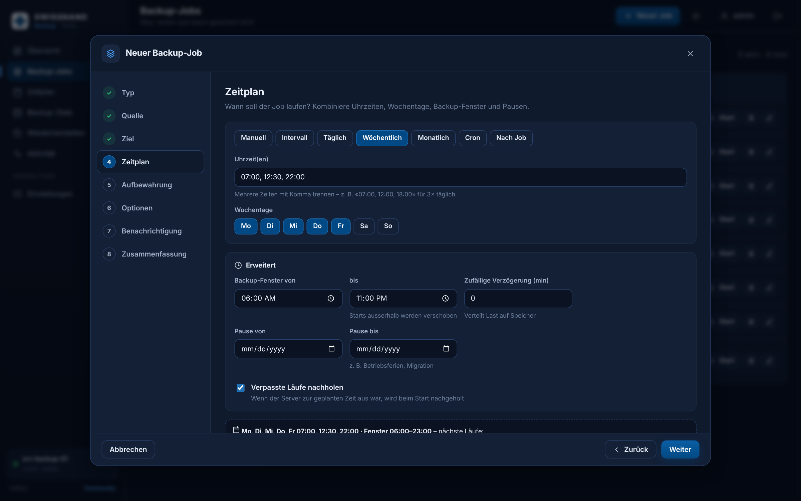 **Zeitplan mit Vorschau** | 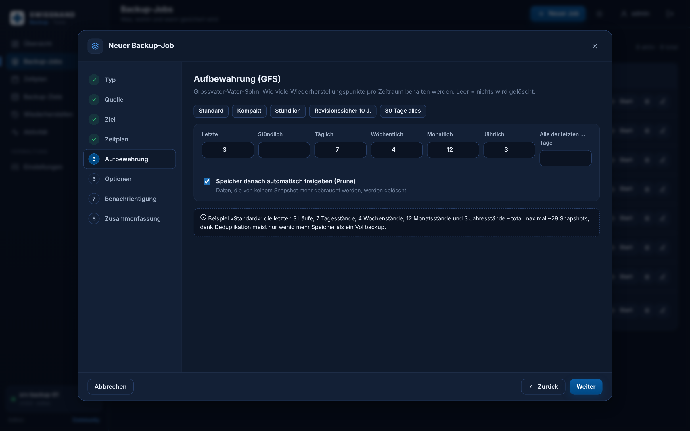 **GFS-Aufbewahrung** |
| 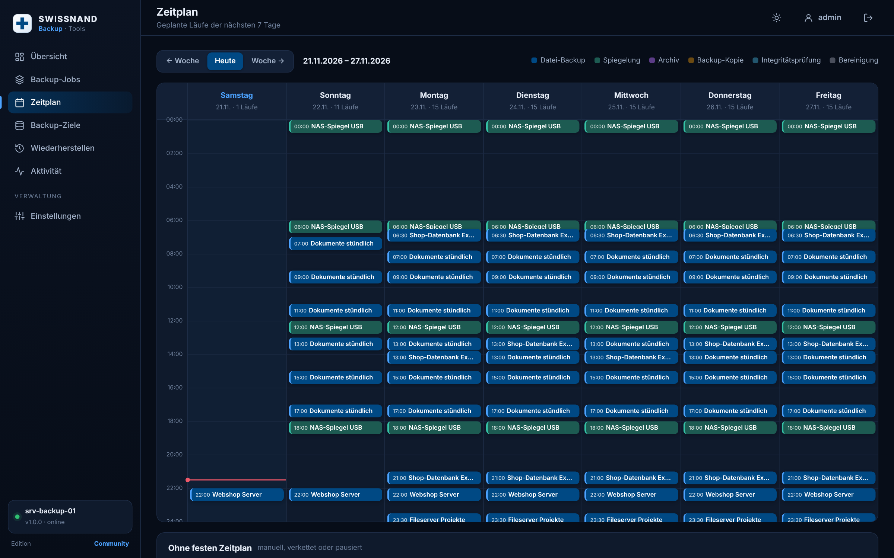 **Wochenkalender** | 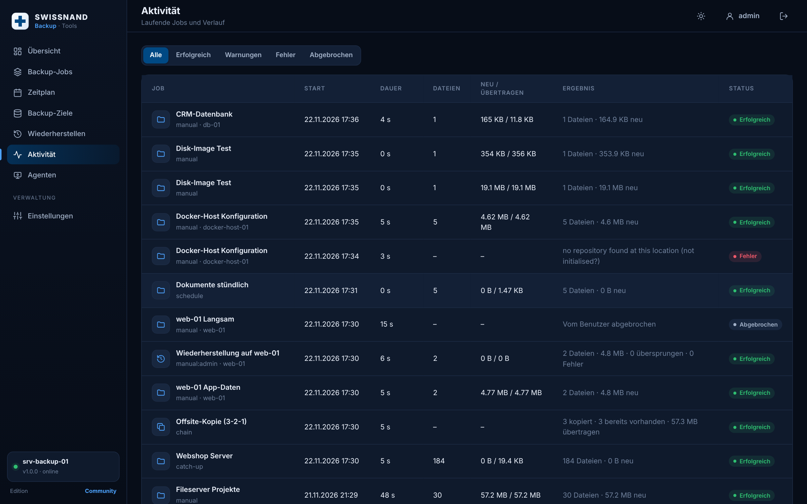 **Live-Fortschritt & Verlauf** |
| 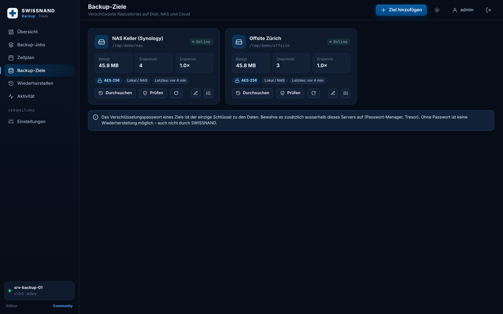 **Backup-Ziele** | 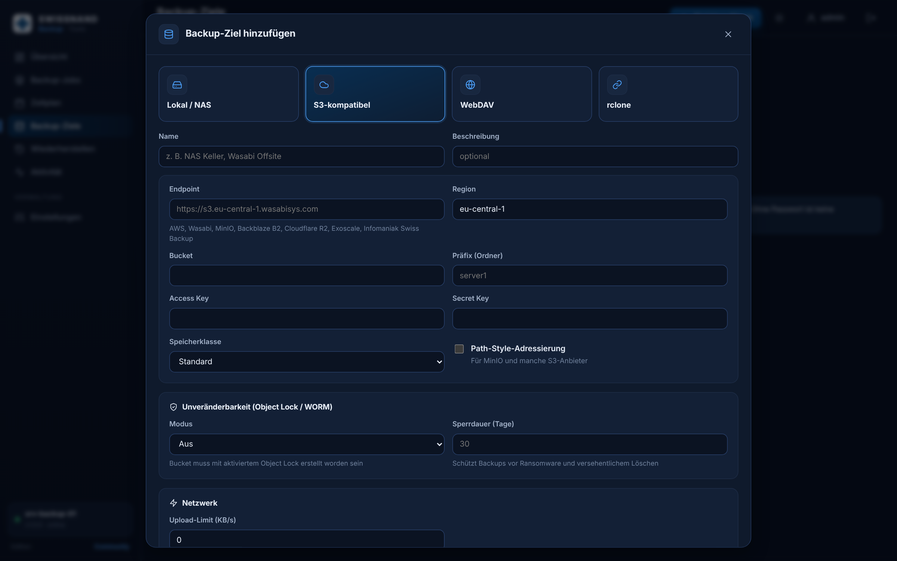 **S3 mit Object Lock** |
|  **Datei-Browser** | 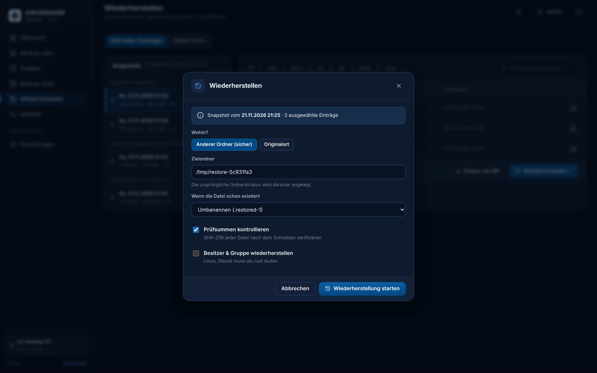 **Wiederherstellung** |
| 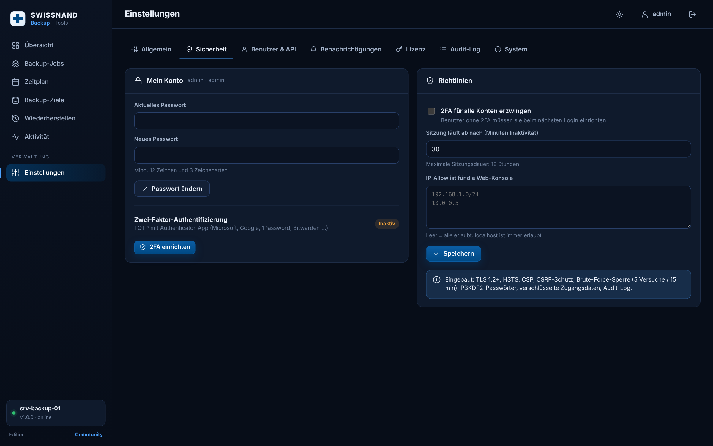 **2FA & Richtlinien** | 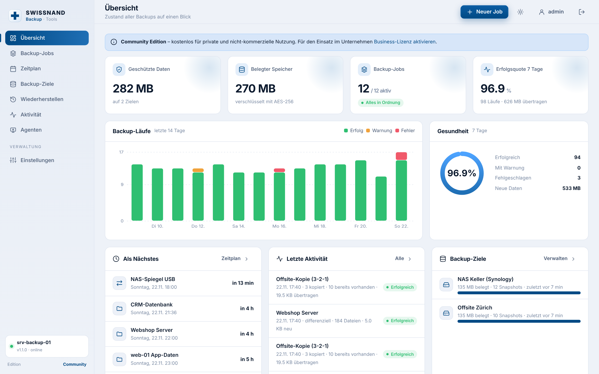 **Light Mode** |

<sub>Screenshots aus einer Demo-Umgebung mit Beispieldaten.</sub>

## Installation

### Ubuntu Server (empfohlen: 22.04 / 24.04)

```bash
# .deb-Paket von der Release-Seite installieren (amd64 oder arm64)
sudo apt install ./snbackup_1.0.0_amd64.deb

# Dienst läuft danach automatisch. Erstes Admin-Passwort anzeigen:
sudo cat /var/lib/snbackup/initial-admin-password
```

Oder ohne Paket:

```bash
curl -fsSLO https://github.com/swissnand/snbackup/releases/latest/download/snbackup-linux-amd64.tar.gz
tar xzf snbackup-linux-amd64.tar.gz && sudo install -m 0755 snbackup /usr/local/bin/
sudo snbackup service install          # systemd-Dienst einrichten und starten
```

Web-Konsole: **https://&lt;server&gt;:8550**, Benutzer `admin`. Das Startpasswort muss bei der ersten Anmeldung geändert werden.

### Docker

```bash
docker run -d --name snbackup --restart unless-stopped -p 8550:8550 \
  -v snbackup-data:/data -v /mnt/backup:/repo ghcr.io/swissnand/snbackup:latest
docker exec snbackup cat /data/initial-admin-password
```

Vollständiges Beispiel mit Agent: [deploy/docker/docker-compose.yml](deploy/docker/docker-compose.yml).

### Kubernetes

```bash
kubectl apply -k https://github.com/swissnand/snbackup/deploy/kubernetes
kubectl -n snbackup exec deploy/snbackup -- cat /data/initial-admin-password
```

Server als Deployment mit PVC, Health-Checks und optionalem Ingress; Agent als DaemonSet auf allen Nodes: [deploy/kubernetes](deploy/kubernetes).

### Agenten (Backup-Server steuert weitere Rechner)

In der Web-Konsole unter **Agenten → Agent hinzufügen** erzeugst du die fertigen Installationsbefehle. Für Linux sieht das so aus:

```bash
sudo apt install ./snbackup_amd64.deb
sudo snbackup agent enroll --server https://backup01:8550 --token snbe_… --fingerprint sha256:…
sudo snbackup service install --agent
```

Windows: `.\install.ps1 -Agent -Server https://backup01:8550 -Token snbe_… -Fingerprint sha256:…`

### Windows Server (2016 / 2019 / 2022 / 2025)

1. `snbackup-windows-amd64.zip` von der Release-Seite herunterladen und entpacken.
2. PowerShell **als Administrator**:
   ```powershell
   .\install.ps1
   ```
   Das Skript kopiert das Programm nach `C:\Program Files\SWISSNAND\Backup`, fügt es dem PATH hinzu, richtet den Dienst (Konto SYSTEM, Autostart, automatischer Neustart) und die Firewall-Regel ein und öffnet die Web-Konsole.
3. Erstes Passwort: `C:\ProgramData\SWISSNAND\Backup\initial-admin-password`

Im Terminal stehen danach alle Befehle zur Verfügung (`snbackup help`).

## Kommandozeile

```bash
# Server-Jobs
snbackup job list
snbackup job run "Webshop Server" --full
snbackup job history

# Direkt mit einem Repository arbeiten (ohne Server)
export SNB_REPO=/mnt/nas/backup           # oder s3:https://s3.wasabisys.com/bucket/srv1, webdav:https://…, rclone:nas:backup
snbackup init
snbackup backup /etc /home /var/www --exclude node_modules --exclude '*.tmp' --tag produktion
snbackup backup /srv --full            # Vollbackup
snbackup backup /srv --differential    # seit dem letzten Vollbackup
pg_dump -Fc shop | snbackup backup --stdin-name shop.dump
snbackup snapshots
snbackup ls latest /var/www
snbackup restore latest --target /tmp/restore --include /var/www/shop --verify
snbackup dump 3f2a9c1e /etc/nginx/nginx.conf > nginx.conf
snbackup forget --keep-daily 7 --keep-weekly 4 --keep-monthly 12 --prune
snbackup verify --read-data 10
snbackup copy --to s3:https://s3.eu-central-1.wasabisys.com/offsite/srv1 --to-password-file /root/offsite.pw
snbackup archive create --out /mnt/usb/etc.tar.gz.snarc /etc
snbackup user reset admin                 # Notfall: Passwort zurücksetzen
```

Passwörter kommen aus `SNB_PASSWORD`, `--password-file` oder werden verdeckt abgefragt. Vollständige Referenz: [docs/HANDBUCH.md](docs/HANDBUCH.md).

## Editionen & Lizenz

| | **Community** | **Business** | **Enterprise** |
|---|---|---|---|
| Für | Privat, Schulen, gemeinnützige Organisationen | Unternehmen & Selbständige | Grössere Umgebungen, IT-Dienstleister |
| Preis | **kostenlos** | CHF 149 / Server / Jahr | CHF 990 / Jahr, unbegrenzte Server |
| Funktionen | alle | alle | alle |
| Support | Community | E-Mail (2 Werktage) | priorisiert + SLA |

Jede **kommerzielle Nutzung** braucht eine Lizenz, siehe [LICENSE](LICENSE). Der Lizenzschlüssel wird unter *Einstellungen → Lizenz* eingetragen und **offline** geprüft (Ed25519-Signatur, kein «Nach-Hause-Telefonieren»).

## Selbst bauen

```bash
git clone https://github.com/swissnand/snbackup && cd snbackup
make test        # Tests inkl. Race-Detector
make dist        # Linux amd64/arm64 + Windows amd64 nach ./dist
docker build -t snbackup .
```

Benötigt nur Go ≥ 1.24.

## Für Maintainer: Lizenzschlüssel ausstellen

```bash
go run ./cmd/sn-licgen keygen --out signing.key       # EINMALIG, signing.key offline sichern!
# Ausgegebenen Public Key als GitHub-Variable SN_LICENSE_PUBKEY hinterlegen
go run ./cmd/sn-licgen issue --key signing.key --customer "Muster AG" --edition business --servers 3 --months 12
```

---

<p align="center">© 2026 SWISSNAND · <a href="https://tools.swissnand.com">tools.swissnand.com</a></p>
