<p align="center">
  
</p>

<h1 align="center">SWISSNAND Backup</h1>

<p align="center">
  <b>Ein Backup-Server für dein ganzes Netz – Linux, Windows, Docker und Kubernetes.</b><br>
  Verschlüsselt, dedupliziert, mit Web-Konsole und Kommandozeile.<br>
  Ein Produkt von <b>SWISSNAND Tools</b> · <a href="https://tools.swissnand.com/backup">tools.swissnand.com/backup</a>
</p>

<p align="center">
  
  
  
  
  
  
</p>

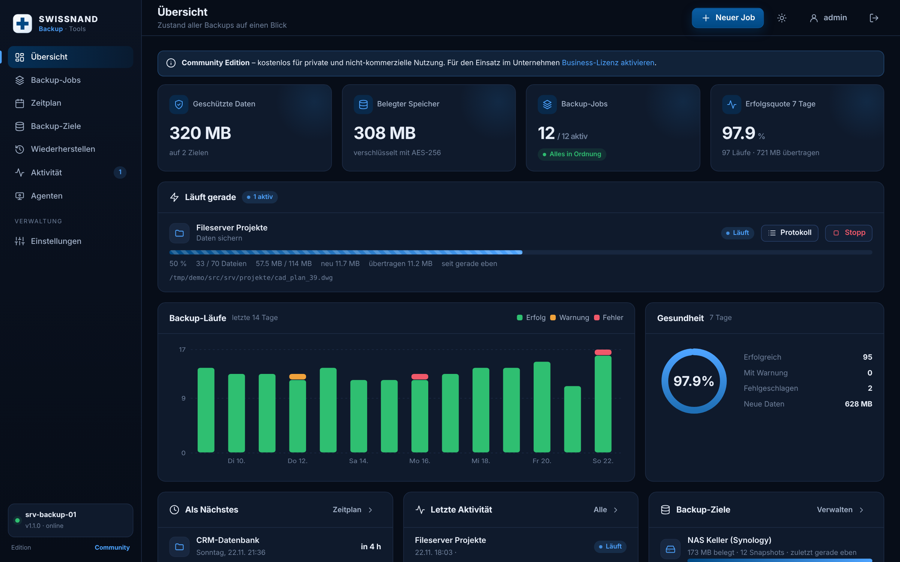

## Was SWISSNAND Backup kann

- **Zentraler Backup-Server:** Ein Server plant alle Backups. Auf den anderen Rechnern läuft ein kleiner Agent, der seine Aufträge verschlüsselt abholt. Die Rechner brauchen keine offenen Ports.
- **Voll, inkrementell oder differenziell:** pro Job wählbar, auch kombiniert (z. B. täglich differenziell, sonntags voll). Jeder Snapshot lässt sich allein vollständig wiederherstellen.
- **14 Backup-Varianten:** Dateien, PostgreSQL, MySQL/MariaDB, Docker-Volumes, Proxmox-VMs, Hyper-V, Disk-Images, Windows Bare Metal, Befehle, Spiegelung, Archiv, Kopie ausser Haus (3-2-1), Integritätsprüfung, Bereinigung.
- **Ziele:** lokale Disk, NAS (NFS/SMB), S3 (AWS, Wasabi, MinIO, Infomaniak, Exoscale …) mit Object Lock gegen Ransomware, WebDAV, über rclone 70+ weitere.
- **Flexible Zeitpläne:** Intervall, mehrere Uhrzeiten, Wochentage, Monatstage, Cron, Verkettung, Backup-Fenster, Pausen.
- **Sicher:** AES-256-GCM vor dem Upload, 2FA, Rollen, Audit-Log, keine Fremdabhängigkeiten.
- **Einfach:** Ein Assistent führt in wenigen Schritten zum fertigen Job. Wiederherstellen per Klick.

---

## Installation

Die Installation hat drei Teile: **Backup-Server installieren → anmelden → Agenten hinzufügen** (optional). Die Downloads findest du unter [Releases](https://github.com/swissnand/snbackup/releases/latest).

### Schritt 1 – Backup-Server installieren

Wähle **eine** Variante:

#### Ubuntu Server (empfohlen)

```bash
curl -fsSLO https://github.com/swissnand/snbackup/releases/latest/download/snbackup_amd64.deb
sudo apt install ./snbackup_amd64.deb
```

Der Dienst läuft danach automatisch. Für ARM-Server (z. B. Raspberry Pi) heisst die Datei `snbackup_arm64.deb`.

#### Windows Server

1. [`snbackup-windows-amd64.zip`](https://github.com/swissnand/snbackup/releases/latest/download/snbackup-windows-amd64.zip) herunterladen und entpacken.
2. PowerShell **als Administrator** im entpackten Ordner öffnen:
   ```powershell
   .\install.ps1
   ```

#### Docker

```bash
docker run -d --name snbackup --restart unless-stopped \
  -p 8550:8550 -v snbackup-data:/data \
  ghcr.io/swissnand/snbackup:latest
```

Mit docker compose: [deploy/docker/docker-compose.yml](deploy/docker/docker-compose.yml)

#### Kubernetes

```bash
kubectl apply -k "https://github.com/swissnand/snbackup//deploy/kubernetes?ref=main"
```

Details: [deploy/kubernetes](deploy/kubernetes)

### Schritt 2 – Anmelden

1. Öffne im Browser **`https://<dein-server>:8550`**. Der Browser warnt beim ersten Mal vor dem selbst erstellten Zertifikat. Das ist normal, einfach fortfahren.
2. Benutzer **`admin`**, das Startpasswort zeigt dieser Befehl an:

   | Ubuntu | Windows | Docker | Kubernetes |
   |---|---|---|---|
   | `sudo cat /var/lib/snbackup/initial-admin-password` | Datei `C:\ProgramData\SWISSNAND\Backup\initial-admin-password` | `docker exec snbackup cat /data/initial-admin-password` | `kubectl -n snbackup exec deploy/snbackup -- cat /data/initial-admin-password` |

3. Beim ersten Login legst du ein eigenes Passwort fest. Danach am besten gleich unter *Einstellungen → Sicherheit* die Zwei-Faktor-Anmeldung einschalten.

### Schritt 3 – Backup-Ziel anlegen

*Backup-Ziele → Ziel hinzufügen*: Typ wählen (Lokal/NAS, S3, WebDAV, rclone) und **Verbindung testen**. Dann mit «Starkes Passwort generieren» ein Verschlüsselungspasswort erzeugen.

> **Wichtig:** Das Verschlüsselungspasswort ist der einzige Schlüssel zu deinen Daten. Bewahre es zusätzlich ausserhalb des Servers auf (Passwort-Manager). Ohne dieses Passwort ist keine Wiederherstellung möglich.

### Schritt 4 – Agenten hinzufügen (für weitere Rechner)

*Agenten → Agent hinzufügen → Installationsbefehle erzeugen.* Die Konsole zeigt dir fertige Befehle mit Token und Zertifikats-Fingerabdruck. Du kopierst sie und führst sie auf dem Rechner aus:

| Rechner | Befehl (Beispiel) |
|---|---|
| **Linux** | `sudo apt install ./snbackup_amd64.deb`<br>`sudo snbackup agent enroll --server https://backup01:8550 --token snbe_… --fingerprint sha256:…`<br>`sudo snbackup service install --agent` |
| **Windows** | `.\install.ps1 -Agent -Server https://backup01:8550 -Token snbe_… -Fingerprint sha256:…` |
| **Docker** | `docker run -d --name snbackup-agent -v /:/host:ro -e SNB_SERVER=… -e SNB_ENROLL_TOKEN=… -e SNB_HOST_ROOT=/host ghcr.io/swissnand/snbackup agent run` |
| **Kubernetes** | Secret anlegen und [agent-daemonset.yaml](deploy/kubernetes/agent-daemonset.yaml) anwenden – ein Agent pro Node |

Nach wenigen Sekunden erscheint der Agent in der Liste.

> **Brauche ich überall einen Agent?** Nein. NAS-Freigaben und Datenbanken übers Netz sichert der Backup-Server selbst. Einen Agent brauchst du für lokale Dateien, Windows-Schattenkopien (VSS), Hyper-V, Proxmox, Disk-Images und Bare Metal.

### Schritt 5 – Ersten Job erstellen

*Backup-Jobs → Neuer Job.* Der Assistent fragt nacheinander:

1. **Typ** – was gesichert wird
2. **Quelle** – auf welchem Rechner und welche Ordner/Datenbanken
3. **Ziel** und **Modus** – voll, inkrementell oder differenziell
4. **Zeitplan** – mit Vorschau der nächsten Läufe
5. **Aufbewahrung** – Vorlagen wie «Standard» (7 Tage, 4 Wochen, 12 Monate, 3 Jahre)
6. **Optionen, Benachrichtigung, Name** – fertig

Mit **Start** testest du den Job sofort. Unter *Wiederherstellen* siehst du danach alle Dateien.

---

## Screenshots

| | |
|---|---|
| 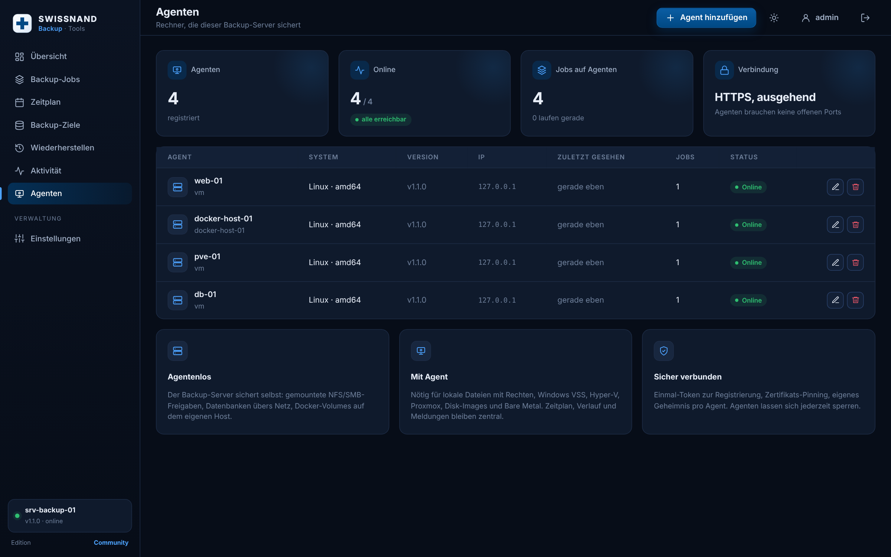 **Agenten im ganzen Netz** | 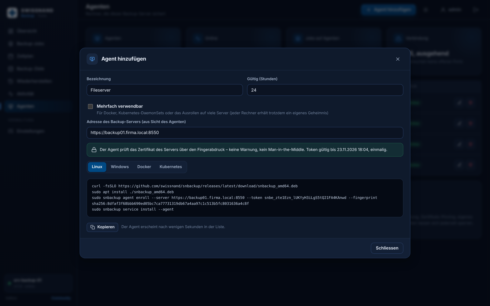 **Agent hinzufügen per Copy & Paste** |
| 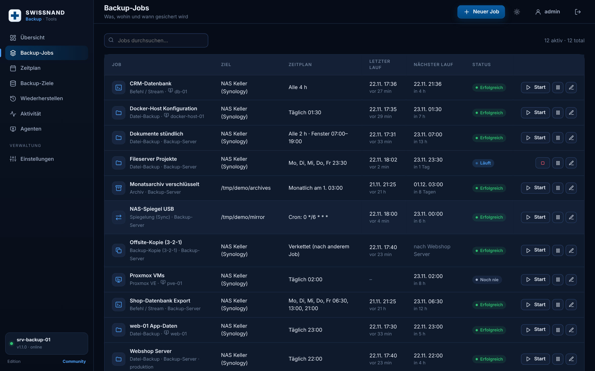 **Backup-Jobs pro Rechner** |  **14 Backup-Varianten** |
| 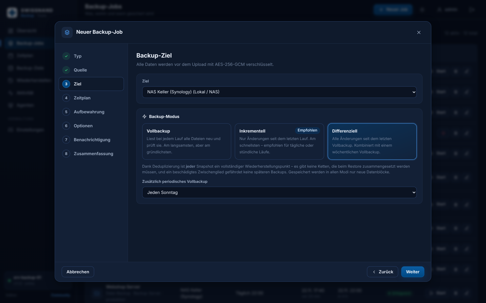 **Voll, inkrementell, differenziell** | 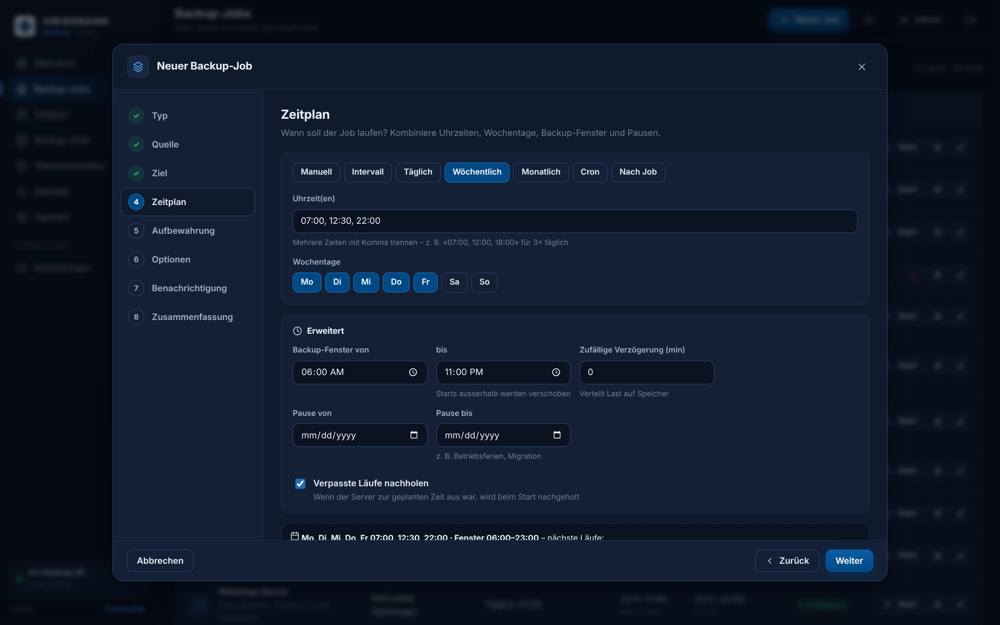 **Zeitplan mit Vorschau** |
| 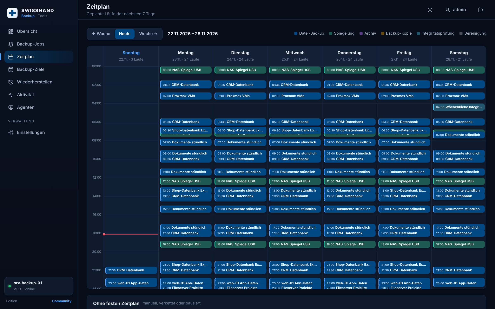 **Wochenkalender** | 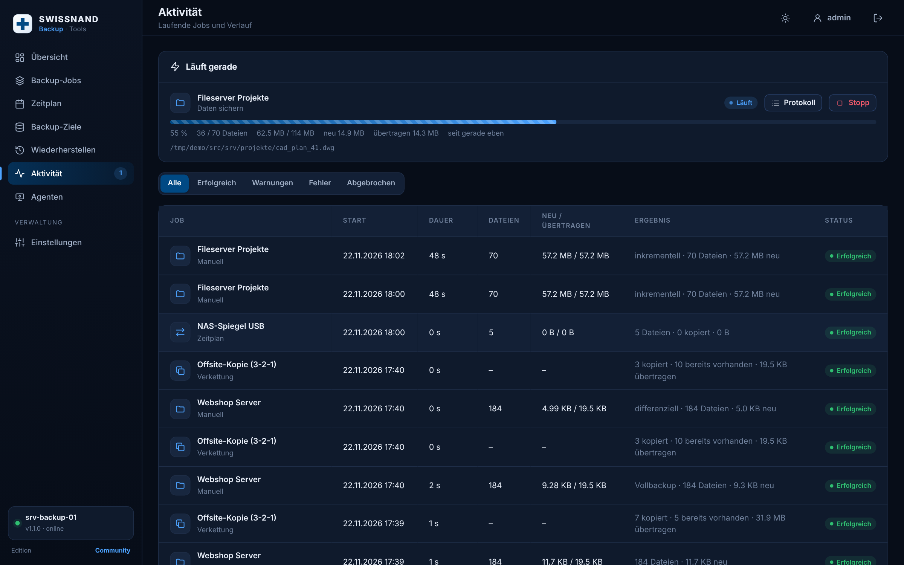 **Live-Fortschritt und Verlauf** |
| 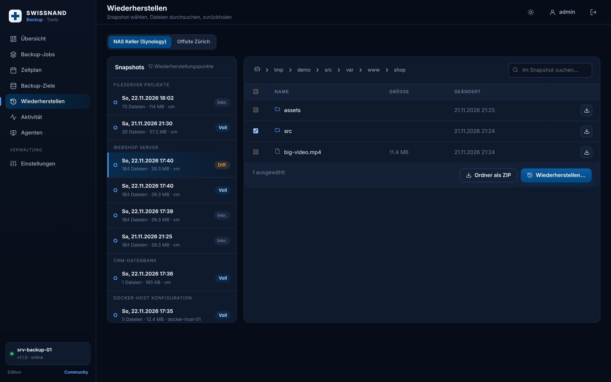 **Dateien durchsuchen** | 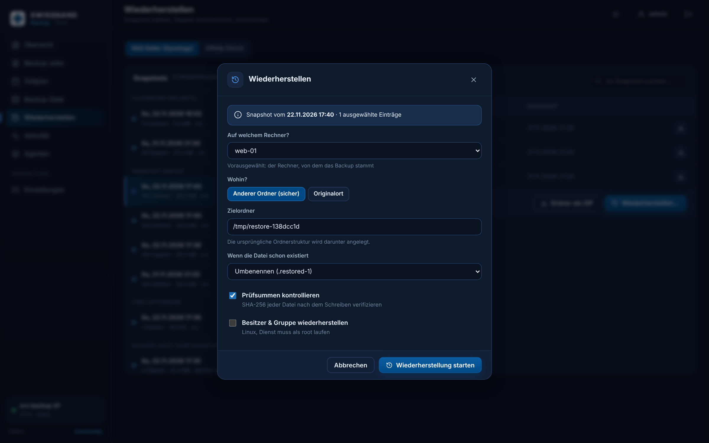 **Wiederherstellen auf beliebigen Rechner** |
| 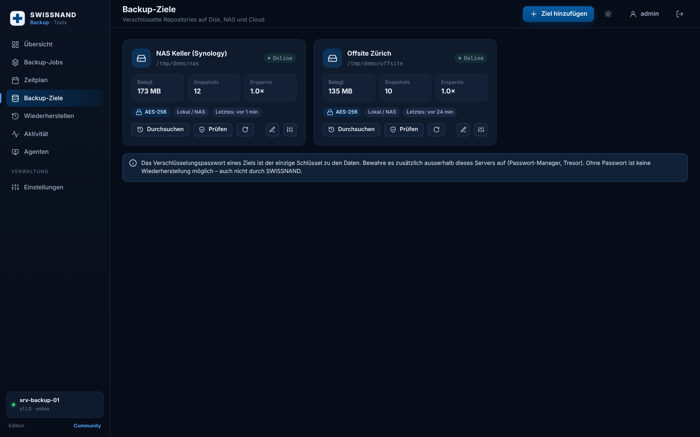 **Backup-Ziele** | 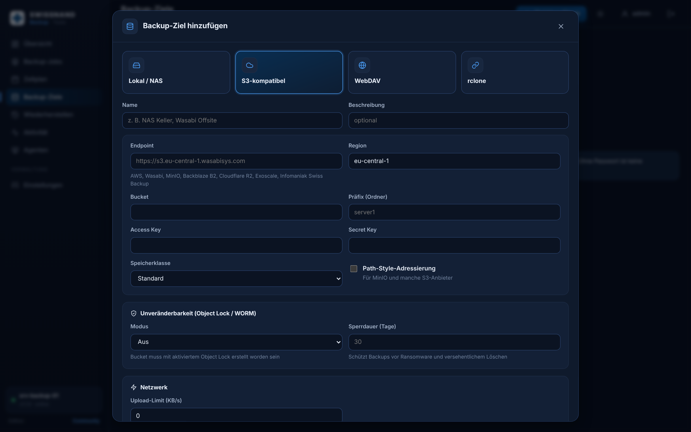 **S3 mit Object Lock** |
| 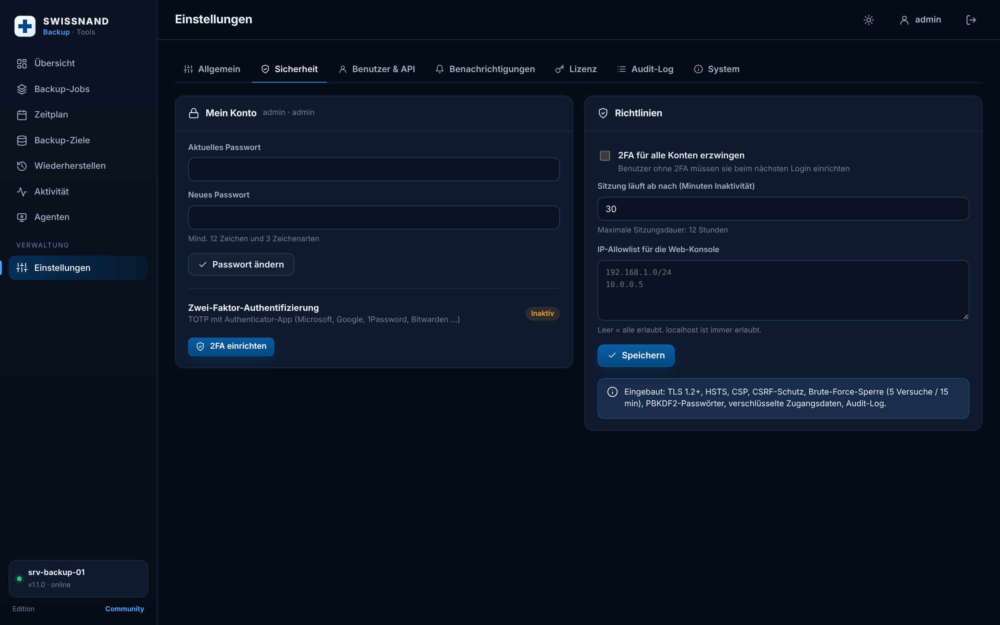 **2FA und Richtlinien** | 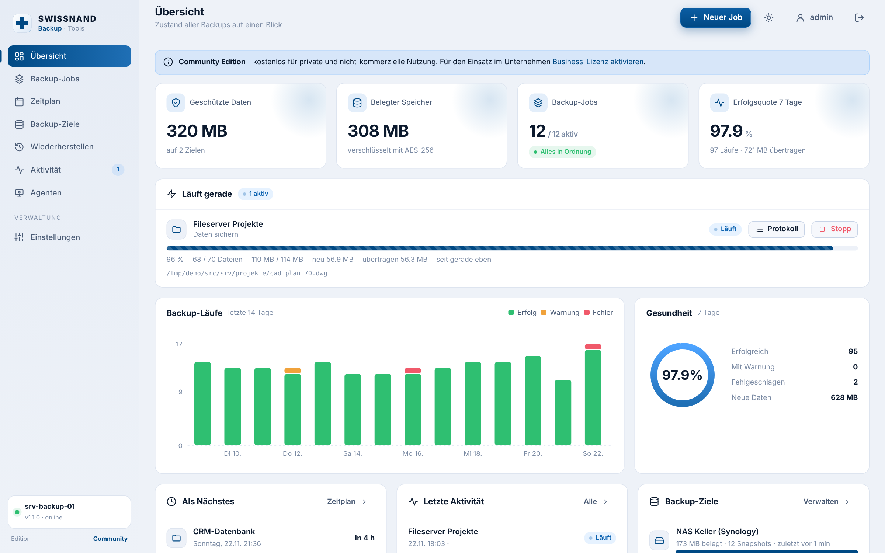 **Heller Modus** |

<sub>Screenshots aus einer Demo-Umgebung mit Beispieldaten. Alle 21 Bilder: [docs/screenshots](docs/screenshots).</sub>

## Kommandozeile

Alles, was die Web-Konsole kann, geht auch im Terminal (Linux und Windows):

```bash
snbackup job list                        # Jobs mit nächstem Lauf
snbackup job run "Webshop Server"        # sofort ausführen
snbackup job history                     # letzte Läufe

# Direkt mit einem Ziel arbeiten, ohne Server:
export SNB_REPO=/mnt/nas/backup
snbackup init
snbackup backup /etc /home --exclude '*.tmp'          # inkrementell
snbackup backup /srv --differential                   # seit dem letzten Vollbackup
snbackup snapshots
snbackup restore latest --target /tmp/restore
```

Vollständige Referenz und Erklärungen: **[Handbuch](docs/HANDBUCH.md)** · Sicherheitsdetails: **[SECURITY.md](SECURITY.md)**

## Sicherheit in Kürze

| | |
|---|---|
| Daten | AES-256-GCM, verschlüsselt **vor** dem Upload, Schlüssel mit PBKDF2 (600 000 Iterationen) |
| Integrität | Jede Datei per SHA-256, jeder Block per HMAC geprüft, regelmässige Prüfjobs |
| Ransomware | S3 Object Lock (unveränderbar), Kopie auf zweites Ziel |
| Agenten | Nur ausgehendes HTTPS, Einmal-Token, Zertifikats-Pinning, einzeln sperrbar |
| Konsole | Nur HTTPS, 2FA, Rollen, Sperre nach Fehlversuchen, IP-Allowlist, Audit-Log |
| Code | Keine Fremdabhängigkeiten, nur die Go-Standardbibliothek |

## Editionen

| | **Community** | **Business** | **Enterprise** |
|---|---|---|---|
| Für | Privat, Schulen, gemeinnützige Organisationen | Firmen und Selbständige | IT-Dienstleister, grössere Umgebungen |
| Preis | **gratis** | CHF 149 pro Server und Jahr | CHF 990 pro Jahr, unbegrenzte Server |
| Funktionen | alle | alle | alle |
| Support | GitHub | E-Mail (2 Werktage) | priorisiert, SLA |

Für jede **kommerzielle Nutzung** brauchst du eine Lizenz, siehe [LICENSE](LICENSE). Den Lizenzschlüssel trägst du unter *Einstellungen → Lizenz* ein. Er wird offline geprüft.

## Selbst bauen

```bash
git clone https://github.com/swissnand/snbackup && cd snbackup
make test     # Tests
make dist     # Linux amd64/arm64 + Windows amd64 nach ./dist
docker build -t snbackup .
```

Benötigt nur Go ≥ 1.24. Hinweise für Maintainer (Releases, Lizenzschlüssel): [docs/MAINTAINER.md](docs/MAINTAINER.md).

---

<p align="center">© 2026 SWISSNAND · <a href="https://tools.swissnand.com/backup">tools.swissnand.com/backup</a></p>
